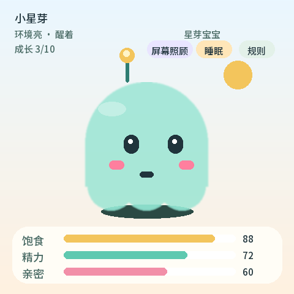

# 星芽小屋 · Mosaico 桌宠

**Star Sprout Cottage · Mosaico Pet**

一只慢吞吞、黏人、爱睡觉的半透明果冻小幽灵。  
A slow, clingy, sleepy translucent jelly ghost living on ESP32-S31.


<p align="center">
  
</p>

> UI 渲染示意，实机以固件为准。  
> Rendered UI preview; the device firmware is the source of truth.

---

## 目录 / Contents

- [中文](#中文)
  - [项目简介](#项目简介)
  - [亮点](#亮点)
  - [硬件](#硬件)
  - [交互规则](#交互规则)
  - [接星星结算](#接星星结算)
  - [睡眠逻辑](#睡眠逻辑)
  - [UI 与幽灵设计](#ui-与幽灵设计)
  - [快速开始](#快速开始)
  - [目录结构](#目录结构)
  - [测试](#测试)
  - [设计文档](#设计文档)
  - [已知限制](#已知限制)
  - [字体与许可证](#字体与许可证)
- [English](#english)
- [License](#license)

---

## 中文

### 项目简介

“星芽小屋”是运行在 **ESP-Mosaico（ESP32-S31）** 上的桌面宠物：

- 480×480 圆形屏幕，LVGL 9.6 界面；
- 半透明果冻幽灵形象，四种成长形态；
- 左右两个实体按键垫：喂食、抱抱、接星星；
- 光敏传感器自动判断白天/夜晚，支持手动睡眠/叫醒覆盖；
- 6 颗 WS2812 灯珠 + 振动马达做反馈。

它不追求“功能堆满”，而是把一个小生命放在桌面上：会慢慢浮动、会黏人、会在你点它的时候害羞地缩成一团。

### 亮点

- **半透明果冻幽灵**：圆头 + 三个底部小波浪；整张图统一透明度，不会因为多个半透明圆叠加而发脏。
- **点一下会害羞**：点击宠物身体，缩成小团 1.2 秒（闭眼、脸红、省略号），不触发喂食/抱抱/游戏等核心规则。
- **慢吞吞**：约 5.8 秒一个来回的轻微上下浮动。
- **四种形态**：星芽宝宝（薄荷）、活泼期（蜜桃）、圆润期（樱粉）、黏人期（薰衣草）。
- **双垫抱抱**：左右垫同时按住 2 秒，进入抱抱模式，心跳节拍 + 亲密值增加。
- **接星星**：3 条轨道、10 秒、6 颗星；左右垫移动，按星数结算精力。
- **光敏睡眠**：环境亮 → 醒；环境暗 → 约 0.8 秒后睡；手动按钮可覆盖，直到环境状态再次变化。
- **清晰的色彩分层**：眼睛、腮红、嘴、天线、高光都是独立不透明层；背景/卡片/按钮使用低饱和但高对比的配色。

### 硬件

| 部件 | 型号 / 说明 |
|---|---|
| 主控 | ESP32-S31（ESP-Mosaico 主控） |
| 屏幕 | CO5300 QSPI 480×480 |
| 触摸 | CST9220 电容触摸（屏幕按钮 + 点击宠物） |
| 交互模块 | 左右两个机械触点垫、光敏电阻、6× WS2812 |
| 反馈 | 振动马达 |
| 音频 | ES8311 预留，当前固件未接入 |

> 交互模块插在右侧槽位时使用 GPIO11/GPIO10；左侧槽位使用 GPIO13/GPIO12。光敏在右侧槽位为 GPIO46（ADC1_CH4），左侧为 GPIO53（ADC2_CH3）。

### 交互规则

| 操作 | 效果 |
|---|---|
| 左垫短按 | 喂食（饱食 +，有冷却） |
| 右垫短按（主界面） | 进入接星星 |
| 左右垫同时按住 2 秒 | 抱抱（亲密 +，心跳） |
| 游戏内左/右垫 | 向左/右移动一格 |
| 点击宠物身体 | 害羞缩团（仅视觉，不改属性） |
| 屏幕“睡眠/叫醒” | 手动睡眠/叫醒覆盖 |
| 屏幕“规则” | 打开玩法说明 |
| 屏幕“屏幕照顾” | 打开喂食/抱抱/游戏/睡眠按钮 |
| 游戏“暂停” | 暂停；面板内可返回主界面 |
| 游戏右上“返回” | 直接回主界面（本局消耗照扣） |

### 接星星结算

每局固定消耗 **10 精力**（中途返回也算）。结算奖励按星数四舍五入：

```
奖励 = round(20 × 星数 ÷ 6)
净变化 = 奖励 - 10
```

| 接住星数 | 奖励 | 净变化 |
|---|---|---|
| 6 颗 | +20 | **+10** |
| 5 颗 | +17 | **+7** |
| 4 颗 | +13 | **+3** |
| 3 颗 | +10 | **0** |
| 2 颗 | +7 | **-3** |
| 1 颗 | +3 | **-7** |
| 0 颗 | 0 | **-10** |

- 只有接满 6 颗才计入“运动成长”；1–5 颗只结算精力。
- 开局需要至少 10 精力；不足时提示“精力不够”。
- 精力按 0–100 截断。

### 睡眠逻辑

- 光敏原始值高于 **30000**（右侧槽位）判定为“暗”；低于则“亮”。
- 暗状态持续约 **800 ms** 后进入睡眠；亮状态持续约 800 ms 后自动醒。
- 手动“睡眠/叫醒”会覆盖自动判断，直到环境亮/暗状态**再次变化一次**。
- 阈值在 [`components/interaction_module/src/interaction_module.c`](firmware/components/interaction_module/src/interaction_module.c) 的 `IM_LDR_DARK_RAW`，可按房间光线微调。

### UI 与幽灵设计

- **幽灵剪影**：由 `tools/gen_ghost.py` 生成 220×220 ARGB8888 图，单图统一透明度；身体按形态染色。
- **独立五官**：眼睛/高光/腮红/嘴/天线/顶部高光都是独立对象，保证不被半透明身体“吃掉”。
- **配色**：
  - 白天背景 `#EAF7FF → #FFF1E0`
  - 夜晚背景 `#1E2142 → #4A3F6B`
  - 宝宝薄荷 `#8FE3D0`、活泼蜜桃 `#FFB877`、圆润樱粉 `#F6A6C1`、黏人薰衣草 `#B9A7F5`
  - 眼睛/嘴 `#20343C`，腮红 `#FF7F9E`
- **害羞缩团**：点击宠物后显示 1.2 秒的小圆团（闭眼、脸红、省略号），随后恢复；不改变任何属性。
- **慢浮动**：`anim_cb` 每 120 ms 推进相位，约 5.8 秒一个来回。

硬件交互总览见 [`docs/hardware-map-v0.3.png`](docs/hardware-map-v0.3.png)。

### 快速开始

#### A. 直接烧录预编译固件

预编译文件在 [`firmware/dist/`](firmware/dist/)：

- `star_pet.bin`（应用）
- `bootloader/bootloader.bin`
- `partition_table/partition-table.bin`
- `flash_args`
- `SHA256.txt`

```bash
cd firmware/dist
esptool --chip esp32s31 -p /dev/cu.usbmodem101 -b 460800 \
  --before default-reset --after hard-reset write-flash @flash_args
```

如果板子没有自动复位：**按住 BOOT → 点 RESET → 继续按 BOOT 1 秒 → 松开**，然后改用：

```bash
esptool --chip esp32s31 -p /dev/cu.usbmodem101 -b 74880 \
  --before no-reset --after hard-reset write-flash @flash_args
```

#### B. 从源码构建

要求：

- ESP-IDF **6.1.1**（target `esp32s31`）
- Python 3 / 网络（首次构建由 component manager 拉取 LVGL、CO5300、CST9220 等依赖）

```bash
. $IDF_PATH/export.sh
cd firmware
idf.py build
idf.py -p /dev/cu.usbmodem101 flash monitor
```

依赖写在 [`firmware/main/idf_component.yml`](firmware/main/idf_component.yml)，首次构建会生成 `managed_components/` 和 `dependencies.lock`；前者已加入 `.gitignore`。

### 目录结构

```text
.
├── README.md
├── LICENSE
├── LICENSES/
│   └── NotoSansSC-OFL.txt
├── assets/
│   └── preview.png
├── docs/
│   ├── hardware-map-v0.3.png
│   └── interaction-plan-v0.3.md
└── firmware/
    ├── CMakeLists.txt
    ├── sdkconfig
    ├── sdkconfig.defaults
    ├── partitions.csv
    ├── main/
    │   ├── main.c
    │   └── idf_component.yml
    ├── components/
    │   ├── pet_core/          # 纯 C 状态机（可主机测试）
    │   ├── pet_store/         # NVS 持久化
    │   ├── interaction_module/# 双垫、LDR、WS2812
    │   ├── peripherals/       # LCD / 触摸 / 电源 / I2C
    │   └── pet_ui/            # LVGL 界面、字体、幽灵图
    ├── tests/                 # 主机测试
    ├── tools/                 # 字体 / 幽灵图生成脚本
    └── dist/                  # 预编译固件
```

### 测试

状态机可以脱离硬件在主机上跑：

```bash
cd firmware
./tests/run_host_tests.sh
```

当前输出：

```text
PASS: pet_core v0.3 tests
  feeds=13 hugs=3 game_won=1 game_lost=1 sleep=2 wake=2 evolve=1 idle=2
```

### 设计文档

- [`docs/interaction-plan-v0.3.md`](docs/interaction-plan-v0.3.md)：交互方案与设计历程。
- [`docs/hardware-map-v0.3.png`](docs/hardware-map-v0.3.png)：硬件互动地图。

> 设计文档是 v0.3 基线；最终行为以本 README 和代码为准（例如睡眠已改为纯光敏 + 手动覆盖，接星已改为每局固定消耗 10、按星数奖励）。

### 已知限制

- **ES8311 音频**未接入：当前没有声音反馈。
- **屏幕触摸**用于界面按钮与点击宠物；左右操作使用交互模块的机械触点垫。
- **无 OTA**：通过 USB 烧录。
- 部分 USB 线/Hub 在高速烧录时可能掉线；建议直连 Mac，必要时用 74880 波特率。
- 光敏阈值是经验值，不同房间/模块可能需要微调 `IM_LDR_DARK_RAW`。

### 字体与许可证

- 代码：**MIT**，见 [`LICENSE`](LICENSE)。
- 字体：`lv_font_starpet_18.c` 是从 **Noto Sans SC（SIL Open Font License 1.1）** 生成的 18 px 子集，许可证见 [`LICENSES/NotoSansSC-OFL.txt`](LICENSES/NotoSansSC-OFL.txt)。字体只包含界面实际使用的 208 个非 ASCII 字形（汉字/标点）+ ASCII。
- 第三方组件：LVGL、Espressif CO5300/CST9220 驱动等由 `idf_component.yml` 拉取，遵循各自许可证。
- 触摸复位/旋转的少量实现参考了 Espressif ESP-Mosaico BSP（Apache-2.0），在此致谢。

---

## English

### Overview

**Star Sprout Cottage** is a desktop pet for **ESP-Mosaico (ESP32-S31)**:

- 480×480 round display, LVGL 9.6 UI;
- a translucent jelly ghost with four growth forms;
- two physical pads for feeding, hugging, and a star-catching mini-game;
- an LDR for automatic day/night sleep, plus a manual sleep/wake override;
- 6× WS2812 LEDs and a vibration motor for feedback.

It is intentionally small and gentle: the ghost bobs slowly, clings to you, and curls into a shy ball when tapped.

### Features

- **Translucent jelly ghost** — rounded head and three soft bottom lobes, rendered as one alpha image so overlapping translucent parts never look muddy.
- **Tap to shy** — tapping the pet shows a 1.2 s curled-up ball (closed eyes, blush, ellipsis). It does not change stats.
- **Slow bob** — a gentle ~5.8 s up/down cycle.
- **Four forms** — baby mint, active peach, round rose, clingy lavender.
- **Hug** — hold both pads for 2 s; heartbeat feedback and intimacy increase.
- **Star game** — 3 lanes, 10 s, 6 stars; left/right pads move the pet.
- **LDR sleep** — bright → awake, dark → sleep after ~0.8 s; manual override persists until the light state changes again.
- **Clear color layers** — eyes, blush, mouth, antenna, and highlights are opaque, independent objects.

### Hardware

| Part | Detail |
|---|---|
| MCU | ESP32-S31 (ESP-Mosaico) |
| Display | CO5300 QSPI 480×480 |
| Touch | CST9220 (UI buttons and pet taps) |
| Interaction module | two mechanical pads, LDR, 6× WS2812 |
| Feedback | vibration motor |
| Audio | ES8311 footprint, not integrated in this firmware |

### Controls

| Action | Result |
|---|---|
| Left pad tap | Feed |
| Right pad tap (main screen) | Start star game |
| Both pads held 2 s | Hug |
| Left/right pad in game | Move one lane |
| Tap pet body | Shy curl (visual only) |
| On-screen sleep/wake | Manual override |
| On-screen rules / care | Help / fallback actions |
| Game pause / return | Pause or leave the round |

### Star game rewards

Every round costs **10 energy** (leaving early also counts).  
`reward = round(20 × stars ÷ 6)`, `net = reward - 10`.

| Stars | Reward | Net |
|---|---|---|
| 6 | +20 | **+10** |
| 5 | +17 | **+7** |
| 4 | +13 | **+3** |
| 3 | +10 | **0** |
| 2 | +7 | **-3** |
| 1 | +3 | **-7** |
| 0 | 0 | **-10** |

Only 6 stars count toward exercise growth. A round needs at least 10 energy to start.

### Build & flash

Requirements: ESP-IDF **6.1.1**, target `esp32s31`, network for the first component fetch.

```bash
. $IDF_PATH/export.sh
cd firmware
idf.py build
idf.py -p /dev/cu.usbmodem101 flash monitor
```

Prebuilt binaries are in [`firmware/dist/`](firmware/dist/). To flash from there:

```bash
cd firmware/dist
esptool --chip esp32s31 -p /dev/cu.usbmodem101 -b 460800 \
  --before default-reset --after hard-reset write-flash @flash_args
```

If auto-reset is not wired, hold BOOT, tap RESET, keep BOOT for ~1 s, then use `--before no-reset` and a lower baud rate such as 74880.

### Known limitations

- ES8311 audio is not implemented.
- The two pads are mechanical contacts; the CST9220 touch is used for on-screen controls and pet taps.
- No OTA; flashing is over USB.
- LDR thresholds are empirical and may need per-room tuning.

### License

Code is **MIT**. The generated 18 px font is a **Noto Sans SC** subset (208 non-ASCII glyphs + ASCII) under the **SIL Open Font License 1.1** (see [`LICENSES/NotoSansSC-OFL.txt`](LICENSES/NotoSansSC-OFL.txt)). Third-party components follow their own licenses.

---

## License

MIT © 2026 Xiaoxiaokangkang

See [`LICENSE`](LICENSE) for the full text.
